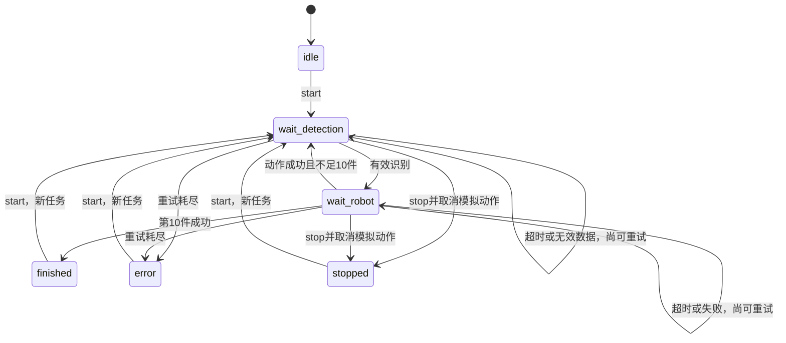

# 工程分析与第一阶段设计

这是单个 `ament_python` 包 `kuavo_sorting`。`package.xml` 声明运行依赖 `rclpy`、`std_msgs`、`launch`、`launch_ros` 与测试依赖 `python3-pytest`；`setup.py` 安装包、ament 索引资源、package.xml、Launch 文件，并注册四个入口。`setup.cfg` 将入口安装至 `lib/kuavo_sorting`，供 `ros2 run` 和 Launch 查找。没有 CMake、自定义 ROS 消息、官方 SDK、硬件驱动或原有测试/CI。

| 文件 | 职责 |
| --- | --- |
| `protocol.py` | 五类清单、10件总量、JSON对象与严格类型/有限坐标校验 |
| `state_machine.py` | 与 ROS 解耦的调度、计数、超时、重试、取消、旧消息过滤 |
| `simulation.py` | 确定性识别与计时动作模拟，支持故障注入和动作去重 |
| `sorting_node.py` | 调度状态机与 ROS 话题之间的适配 |
| `vision_node.py` | 处理模拟识别请求，可丢弃响应测试超时 |
| `robot_node.py` | 处理模拟动作/取消，可注入失败 |
| `task_client.py` | start/stop，等待匹配确认，失败返回非零退出码 |
| `ros_support.py` | Humble 节点清理、关闭流程、状态 QoS |
| `launch/sorting.launch.py` | 启动三节点并传递明确类型的参数 |

## 状态机

状态消息的 `phase` 是内部等待状态，`state` 是事件，例如 `ready`、`running`、`detecting`、`moving`、`retrying`、`completed_item`、`finished`、`stopped`、`busy`、`invalid`、`error`。仅匹配当前动作的成功反馈增加计数。每类最多两件，成功10件必然得到五类各两件。每阶段重试预算独立，每件/新阶段归零，最多执行 `1 + max_retries` 次请求。计时采用 `time.monotonic()`，不受系统时间调整影响。

停止与重试耗尽时向动作节点发送带原 `run_id` 的 cancel。模拟动作只在定时器完成时产出成功；取消会清掉 pending，不会在取消后继续产出该动作的成功。新任务创建 UUID；每次请求创建新 UUID，过滤旧轮次、旧尝试、重复与乱序反馈。识别成功后固定类别和坐标，动作重试保持同一 `operation_id`。

动作模型对运行中的同一操作不重新开始计时，只更新反馈关联；已成功操作缓存成功结果，以处理反馈丢失后的重试。缓存最多128项，仅在当前进程内有效；节点重启不保证操作去重。该机制服务于模拟程序，**不能直接套用为真实硬件安全协议**。实体动作的取消确认、重复执行风险、持久化、真实识别与官方 SDK 集成属于后续阶段，需要真实接口文档和硬件验证。

## 内部话题协议

所有话题均为 `std_msgs/msg/String`。这是项目内部协议，不是 Kuavo 官方接口。

| 话题 | 发布者 → 订阅者 | 数据 |
| --- | --- | --- |
| `/sorting/control` | CLI → 调度 | `{"action":"start或stop","control_id":"UUID"}`，兼容纯文本 start/stop |
| `/sorting/detect_request` | 调度 → 模拟视觉 | `run_id, request_id, seq, attempt` |
| `/sorting/detection` | 模拟视觉 → 调度 | 请求关联字段及 `type, x, y, z` |
| `/sorting/robot_command` | 调度 → 模拟动作 | 请求关联字段及 `action, operation_id, type, bin, pose`；cancel只需action/run_id |
| `/sorting/robot_result` | 模拟动作 → 调度 | `run_id, request_id, seq, success, message` |
| `/sorting/status` | 调度 → CLI/观察者 | `state, phase, run_id, completed, total, counts, attempt, detail, simulated`，指令确认另带control_id |

`seq` 为0..9整数，布尔值不视作整数；`attempt` 从0开始；坐标必须为有限数值。仅接受 JSON 对象，列表/null/缺字段等不会使节点回调崩溃。已关联但无效的业务反馈触发重试；错误轮次/请求的反馈忽略。无法解析的当前阶段消息触发重试并记录错误；这不是面向不可信网络的认证协议。

普通话题使用 reliable/volatile QoS，depth=10；状态使用 reliable/transient_local，depth=10，便于后加入的观察者读取最近状态。CLI 用独有control_id筛选确认，避免将旧状态当作当前指令成功。CLI 的成功只代表指令被接受；未发现节点、无确认、busy返回1，非法CLI参数返回2。

## 修复的原有问题

- 原超时分支先设 idle，日志因而无法报告原等待阶段；现保留原阶段和耗尽原因。
- 原消息仅靠seq关联，stop/start后旧消息可能推进新任务；现关联任务和具体请求。
- 原动作停止未清pending，且写入busy后才访问bin，缺字段可造成状态残留；现先完整校验再改变状态，支持模拟取消。
- 原 JSON 列表可能触发 AttributeError、bool可通过int校验、坐标无校验；现统一严格校验。
- 原客户端读取原始sys.argv且失败返回0；现剥离ROS参数、校验CLI参数、要求匹配确认并返回真实退出码。
- 原无重试、自动化测试、有效README；现增加阶段重试、故障注入、Python/ROS集成测试与CI。

本阶段不实现真正的抓取规划、机器人导航、运动控制、视觉算法或三维仿真，也不声称真实抓取成功。
